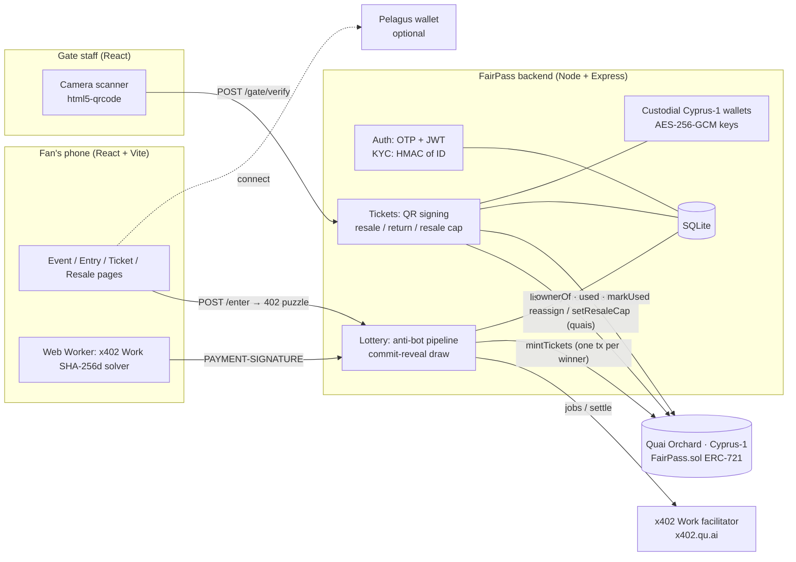

# FairPass

**Fair concert tickets on Quai Network.** A random draw instead of a queue, fair ways to pass a ticket on (return,
gift once, or resell privately or publicly under an organiser-set cap), and a rotating QR that only the real on-chain
owner can produce, so a fake or screenshotted ticket is useless at the gate.

> Hackathon track: Cybersecurity & Blockchain · Problem B2 "Fair tickets"
> Contract (Quai Orchard testnet, Cyprus-1): [`0x0019897D203A86A9B33298B03468Acc15ABd789B`](https://orchard.quaiscan.io/address/0x0019897D203A86A9B33298B03468Acc15ABd789B)

---

## The problem

In September 2024, **1.3 crore people** queued on BookMyShow for Coldplay's three Mumbai concerts. Tickets sold out in
minutes; a police complaint alleged bots took **lakhs of queue places**; tickets reappeared on resale sites for up to
**₹3 lakh**. In October 2024 the Enforcement Directorate raided **5 cities** over **fake tickets** sold on Instagram,
WhatsApp and Telegram. India has no law written specifically against scalping.

Three things went wrong: **speed decided who got tickets** (so bots win), **resale had no ceiling** (so scalping pays),
and **a ticket was just an image** (so fakes and screenshots work).

## The solution

| Pillar | How FairPass does it |
|---|---|
| **1. Fair entry** | A **lottery**, not a race. **One entry per verified person per event**; the fan chooses how many tickets they want. Every entry must carry an **x402 Work proof-of-work** (about a second of hashing for a fan, a million times that for a bot farm sending a million entries, which would also need a million real IDs) and passes a per-IP rate limit. The draw is **commit-reveal**: `sha256(seed)` is public before anyone enters, the seed is revealed at the draw, and anyone can recompute the order. In that order each winner gets the quantity they asked for; when tickets run out, that fan gets what's left and waits for the rest. |
| **2. Fair resale** | Tickets are **ERC-721 NFTs that can only move through the FairPass contract** (plain transfers and approvals revert). Resale price ≤ `face × (100 + cap) / 100`, enforced **on-chain**. **The organiser sets the cap per event** (0–100 %, default 10 %) with `setResaleCap`; purchases re-check the **current** cap, so lowering it makes existing over-cap listings unbuyable (their sellers are warned). **Return to pool**: the seller gets face price back and the ticket goes to the **next fan on the waitlist**. The seller can't pick the buyer, which kills cash side deals. |
| **Pass your ticket on** | A ticket holder gets four options: **Return to pool** (recommended: face price back, ticket goes to the next waitlisted fan), **Gift to a friend** (free, once per ticket, only to a verified user, max 2 gifts per person per event), **Sell privately** (to one person by phone, via a share link; the contract only lets that wallet buy), **Sell publicly** (on the event's Resale tab; waitlisted fans get first pick for 10 minutes). Every sale is capped and paid through the contract, buyers must be verified and solve the x402 Work puzzle, and **all transfers lock 24 h before the show**. A listed ticket can't be used at the gate until the listing is cancelled. |
| **3. Real tickets** | Only tokens minted by the contract exist. The fan's QR = `{tokenId, timestamp, signature}`, **re-signed every 30 s** by the owner's key. The gate checks **fresh (< 30 s)**, **signer == `ownerOf(tokenId)` on-chain**, **not used**, then calls **`markUsed`** on-chain. A screenshot expires; a forged QR has the wrong signer; a fake ticket isn't on-chain. |

Prices are shown in ₹ (the contract works in QUAI; a fixed mock rate `INR_PER_QUAI`, default ₹4,50,000 per QUAI, converts: 0.01 QUAI = ₹4,500).

## Architecture



### What lives on-chain vs off-chain

| On-chain (FairPass.sol on Quai) | Off-chain (backend + SQLite) |
|---|---|
| Which tickets exist (only contract mints) | Phone login, ID verification (only a keyed hash of the ID is stored) |
| Who owns each ticket (`ownerOf`) | Lottery entries, x402 Work proofs, blocked attempts, rate limits |
| Transfer lock: only `buyResale`, `returnToPool`, `reassign` move tokens | Draw seed commitment + reveal (verifiable by anyone via `/draw-proof`) |
| Resale cap per event (organiser-set), checked again at purchase, and the 2% organiser royalty | Seat numbers, ticket quantities, waitlist order |
| Gate check-in (`markUsed`, `used`) and gate staff list | Custodial wallet keys (encrypted), gas sponsoring, mock fiat refunds |
| `ResaleCapChanged`, `TicketMinted`, … events (public history) | Gate pass signing (QR), scan log, ₹ display prices |

### Where the data lives

| Store | What | Where |
|---|---|---|
| **Quai Orchard** | Tickets, owners, public/private listings, gifted flags, used flags, gate staff, the 24 h lock | `FairPass.sol` at the address above |
| **SQLite** (source of truth) | Users, entries, draw, seats, listings, scans, blocked attempts | `backend/data/demo.db` (`npm run demo`) or `backend/data/fairpass.db` |
| **Cloud Firestore** (optional mirror) | A copy of every SQLite row, updated within about a second | `fairpass/live/{table}/{id}` (always the current database; heals itself every minute) |

The Firestore mirror turns on when `FIREBASE_PROJECT_ID` (and the rest of the web config) is set in `backend/.env`.
Every insert, update and delete is copied by SQLite triggers. Documents also carry organiser-readable fields (fan
name and phone, ID type and masked ID such as `XXXX XXXX 1234`, lottery entry number, event name, block/row/seat,
holder and staff names on scans, Quaiscan links), and `event_stats/{eventId}` holds the per-event totals. Each event
document carries the current `resaleCapPct`, the ₹ maximum and the Quaiscan link of the last cap change; the event and
resale pages subscribe to it with `onSnapshot`, so fans see a new cap within seconds (set `VITE_FIREBASE_*` in
`frontend/.env`; without it they poll the API). Listings above a lowered cap carry `listingInvalid`.
There are no passwords (login is phone + OTP, and OTPs are never stored); the full Aadhaar/PAN number is never stored,
only its keyed hash, its type and its last 4 characters. Left out on purpose: custodial wallet keys, and the draw
seed until the draw has happened. Blocked bot attempts are stored as one summary per event (counts by reason + the
latest 50) so a 10,000-request bot attack doesn't use up the free plan's 20,000 writes a day; set
`FIRESTORE_MIRROR_ALL_BLOCKED=1` to store every attempt. `GET /health` shows the mirror's status.

## Run it

**Requirements:** Node 20+ (tested on 24), Git. Windows, macOS or Linux.

```bash
npm install                      # installs all four workspaces
cp backend/.env.example backend/.env   # then fill ORGANISER_PK, REWARD_ADDRESS, JWT_SECRET, SERVER_SECRET
npm run demo                     # starts API (:8080) + app (:5173), seeds demo data, prints logins
```

`backend/.env` needs:

| Variable | Value |
|---|---|
| `ORGANISER_PK` | Private key of the wallet that deployed the contract (contract owner). Cyprus-1, funded with Orchard QUAI. |
| `REWARD_ADDRESS` | Cyprus-1 Quai address that receives x402 Work mining rewards (the organiser's address is fine). |
| `JWT_SECRET`, `SERVER_SECRET` | Any long random strings (`node -e "console.log(require('crypto').randomBytes(32).toString('hex'))"`). |

`npm run demo` resets its own database (`backend/data/demo.db`), creates a fresh event **on Quai** and prints:

| Role | Phone | Notes |
|---|---|---|
| Organiser | 9000000001 | Dashboard: pick the event in the dropdown, run its draw, change its resale cap, create events |
| Gate staff | 9000000002 | Scanner |
| Fans 1-5 | 9000000011 … 9000000015 | Fan 1 (Asha) enters live; fans 2-5 entered World Tour (2, 1, 1, 1 tickets); Ravi and Meera also entered Monsoon Sessions |

Three events are created on Quai, each with its own price and resale cap. The home page lists them as cards; fans
pick one, and an event they already entered shows "Already entered".

| Event | Face price | Resale cap | Tickets in the draw |
|---|---|---|---|
| World Tour · [Headliner] · Mumbai | ₹4,500 | +10% | 4 |
| Monsoon Sessions · Indie Collective · Mumbai | ₹2,500 | +5% | 3 |
| Coastal Beats · Sunset DJ Night · Goa | ₹6,000 | +20% | 5 |

**Every demo login uses OTP `123456`.** (Outside the demo, OTPs are printed in the API console: mock SMS.)

### Demo script (≈ 5 minutes)

1. **Bots:** in a second terminal run `npm run bot-attack`. 10,000 entry attempts → **9,998 blocked** (no account,
   no verified ID, duplicate ID, rate limit, missing or fake proof-of-work). Open the **organiser dashboard**: the red
   "Bot attempts blocked" card and the per-reason bars.
2. **Fair entry:** log in as **Asha** → pick an event card → *Enter lottery* → choose how many tickets (+/−) → watch the checklist solve
   the **anti-bot puzzle** (real x402 Work) → entry number. As organiser, **Run draw** → winners are **minted on Quai**
   (one transaction per winner; links in "On-chain activity"). "Draw proof → Verify in this browser" recomputes the
   draw from the revealed seed, including who got only part of their quantity.
3. **Sell publicly:** as a winner (the draw proof shows who won) → ticket → **Pass it on** → *Sell publicly* → type a
   price above the max (red, button disabled) → list at the max. Open the event's **Resale** tab: the listing is there
   live, marked "Waitlist priority — open to all in 9:59". Log in as the **waitlisted** fan → *Buy* → puzzle →
   "Ticket is yours". At the gate, the seller's old QR is now **REJECTED · Not the owner**, the buyer's is **VALID**.
4. **Sell privately / gift:** *Sell privately* → enter a fan's phone (their verified name appears) and a price →
   copy the share link → that fan opens it, sees seat + price, buys. *Gift to a friend* → phone → name → "Gift sent";
   their ticket says "Gift from …", and gifting it again is blocked.
5. **Organiser-controlled cap:** in **Resale settings** lower the cap → existing listings above it become *"invalid –
   above new cap"* and can't be bought (the contract re-checks the cap at purchase). **Return to pool** → the next
   waitlisted fan receives the ticket. The dashboard counts listed / sold publicly / privately / gifted / returned
   and the average markup.
6. **Gate:** as gate staff → *Scan*. Show a winner's live QR on another device (or use *Copy code* → *Paste code*):
   - a QR older than 30 s → **REJECTED · Expired QR**
   - `{"tokenId":999999,...}` → **REJECTED · Not on-chain**
   - the live QR → **VALID · Let them in** (marked used on-chain)
   - scan it again → **REJECTED · Already used**

### Other commands

| Command | What it does |
|---|---|
| `npm run test:contracts` | 39 Hardhat tests for every contract rule (cap, private listings, gifts once, 24 h lock, listed tickets at the gate…) |
| `npm run test:backend` | Integration tests (real Orchard contract + x402 facilitator; sends testnet transactions) |
| `npm test -w frontend` | Browser solver vs the published x402 worked example and the Node verifier |
| `npm run e2e` | "Pass it on" end to end (run the API with `QR_MAX_AGE_SECONDS=300`): over-cap rejected → public listing with waitlist priority → waitlisted fan buys → old QR rejected, new QR valid → private sale via link → gift once, second gift blocked → cap lowered blocks a listing → 24 h lock blocks transfers |
| `npm run bot-attack` | The 10,000-request bot farm simulation |
| `npm run deploy` | Deploy FairPass + demo event to Orchard (needs `contracts/.env` `PRIVATE_KEY`) |
| `npm run dev:backend` / `npm run dev:frontend` | Run each part on its own |

## Sponsor tools used

- **Quai Network**: `FairPass.sol` deployed on Orchard testnet, zone Cyprus-1 (chain 15000); every mint, resale,
  return, reassignment and check-in is a Quai transaction. All app code talks to Quai through the **`quais`** SDK;
  custodial wallets are generated inside Cyprus-1.
- **x402 Work** (`x402-work-client`): the anti-bot proof-of-work on every lottery entry, using the hosted facilitator
  with profile `quai/sha256d-v1`. The official client is Node-only, so FairPass ships a browser port of its solver
  (Web Worker), tested against the published worked example. Solved puzzles are real mining shares paid to the organiser.
- **Pelagus**: optional "Connect Pelagus" in the header (quais `BrowserProvider`, `quai_requestAccounts`).

## Questions judges will ask

**Why blockchain? Couldn't a database do this?**
The two things fans and resellers must trust are *who owns a ticket* and *what resale is allowed*. On-chain, the
transfer lock and the resale cap are enforced by code that nobody can bypass, and every cap change the organiser makes
is a public `ResaleCapChanged` event on Quaiscan. Anyone (a fan, a journalist, the police) can check that a ticket is
real without trusting the seller.
Fakes on Instagram stop working because "is it real?" has a public answer.

**Bots outnumber fans. What stops a farm with real IDs?**
Layers, each raising the cost: one entry per verified person (a million entries need a million IDs, and reused IDs are
caught at KYC); the per-IP rate limit; and the x402 Work puzzle on every entry. There's no per-person ticket cap, but
one person asking for many tickets is still a single entry in the draw, and those tickets can't be scalped. And because it's a lottery, an entry
is just one ticket in a hat: a farm that does get in has no speed advantage, and its tickets can't be scalped
(cap + transfer lock). In our simulation, 9,998 of 10,000 bot attempts are blocked; the 2 that get in had to behave
exactly like 2 honest fans.

**What about cash side deals ("pay me ₹50,000 on UPI and I'll transfer it")?**
Every way a ticket can move goes through the contract and is capped: a public or private sale can't exceed face + the
organiser's cap, and a free gift works only once per ticket and only to a verified person. So "₹50,000 on UPI, then I'll
gift it" works at most once and only before the 24 h lock, and the buyer can't pass it on again by gift. Returning
to the pool gives the ticket to the next person on the waitlist, not someone the seller chooses. At the gate, the QR must be signed by the on-chain owner, so lending the
login is the only workaround, and the holder's name is shown to staff.

**What if my phone dies at the gate?**
The ticket isn't the phone: it's the token owned by your account. Log in on any phone (OTP) and a fresh QR is
generated. Staff can also see the holder's name and seat. (A production version would add a staff-side lookup by ID.)

**Do fans need a crypto wallet or gas?**
No. Each fan gets a **custodial Cyprus-1 wallet** created by the backend (key encrypted with AES-256-GCM). The
organiser wallet sponsors gas and, in this demo, mocks the fiat payment (UPI in production). Fans who want
self-custody can connect **Pelagus**.

**Privacy: you're collecting Aadhaar numbers?**
We never store the ID number. We store `HMAC-SHA256(server secret, ID)`: the same ID always gives the same fingerprint
(so duplicates are caught), but the fingerprint can't be reversed or brute-forced without the server secret (a plain
SHA-256 of a 12-digit Aadhaar could be). Nothing personal goes on-chain: the chain sees only wallet addresses and token ids.

## What's mocked

| Mocked | In production |
|---|---|
| SMS OTP (printed to the API console; demo uses `123456`) | SMS gateway |
| KYC (format check of Aadhaar / PAN; keyed hash stored) | DigiLocker / Aadhaar e-KYC |
| ₹ prices (fixed rate `INR_PER_QUAI`) | Live price feed or rupee-pegged token |
| Payments and refunds (organiser wallet funds custodial wallets) | UPI / card payment gateway |
| Gas | Paid by the organiser wallet (sponsored) |

## Project layout

```
contracts/   Hardhat 2 · FairPass.sol (Solidity 0.8.20, OpenZeppelin 5.4.0) · deploy script · 25 tests
backend/     Express 5 · better-sqlite3 · JWT · quais · x402-work-client · firebase (Firestore mirror) · integration tests
frontend/    React 19 · Vite · Tailwind v4 · react-router · qrcode.react · html5-qrcode · firebase (live resale cap) · x402 Work browser solver
scripts/     demo.js · bot-attack.js · e2e.js
```

Details for contributors (Quai and x402 gotchas we hit) are in [CLAUDE.md](CLAUDE.md).
